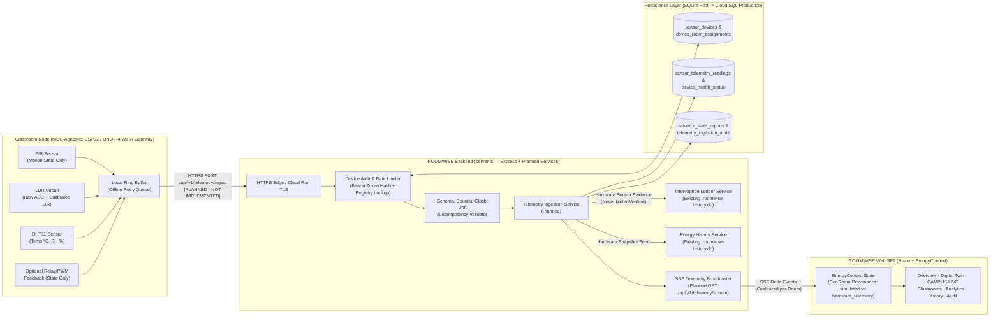
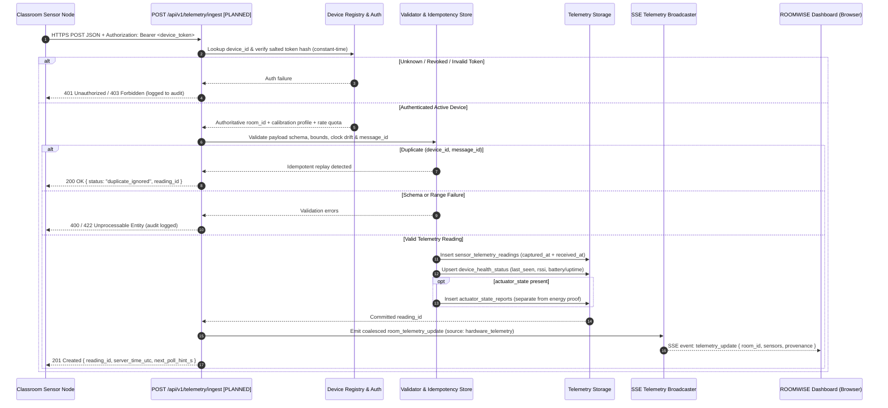

# ROOMWISE — Future Real-Time Sensor Telemetry Ingestion Architecture

> **DOCUMENT STATUS: ARCHITECTURE DESIGN ONLY — NOT IMPLEMENTED IN RUNTIME CODE**
>
> This document specifies the planned future hardware-to-cloud ingestion architecture for **ROOMWISE** at **DAV Model School, IIT Kharagpur**.
> - **No** `/api/v1/telemetry/ingest` route exists in `server.ts`.
> - **No** live hardware telemetry streams, device credentials, or hardware telemetry database tables have been created.
> - All current classroom sensor states (`PIR`, `LDR` lux, `DHT11` temperature/humidity) and intervention records in ROOMWISE remain **simulated** until a dedicated implementation milestone executes the phases outlined in Section 15.

---

## 1. Existing-System Architecture Assessment

Inspection of the current ROOMWISE repository reveals the following concrete runtime architecture:

| Layer | Actual Current Implementation | Engineering Implications for Future Hardware Telemetry |
|---|---|---|
| **Runtime & HTTP Server** | Node.js 22 (ESM) running `express` `4.21.2` via `server.ts` (`"dev": "tsx server.ts"`, `"start": "node server.ts"`) listening on `PORT` (default `3000`). `app.set('trust proxy', 1)` is configured; JSON body limit defaults to `256kb` globally (with explicit `10mb`/`2mb` overrides for attendance parsing). | Express already acts as the unified API + static SPA server. Future telemetry ingestion fits cleanly as a versioned route group (`/api/v1/telemetry/*`) without adding a separate microservice initially. |
| **Frontend Application** | React `19.0.1` + TypeScript + Vite `8.3.0` SPA (`vite.config.ts`) with central client state in `src/context/EnergyContext.tsx` and auth session management in `src/context/AuthContext.tsx`. Currently `EnergyContext` runs a client-side simulation timer over the 25 canonical rooms in `INITIAL_CLASSROOMS` and synchronizes appliance states with `server.ts` via REST. | Client views (`Overview`, `Digital Twin`, `CAMPUS LIVE`, `Classrooms`, `Analytics`, `Energy History`, `Space Intelligence`, `Energy Audit`, `Reports`) already consume unified `Classroom` state from `EnergyContext` plus REST APIs. Adding a server-pushed room-telemetry stream lets all views update consistently without rewriting every panel. |
| **WebSockets & SSE** | `server.ts` already attaches a `ws` (`8.23.0`) `WebSocketServer` on the shared `http.Server` (via `registerVoiceLiveWebSocket` in `server/voiceLiveBridge.ts`) and maintains an in-memory `sseClients` map for QR authentication challenge push events. | Both SSE (`text/event-stream`) and WebSockets are already proven in this codebase. SSE is lightweight and firewall/proxy-friendly for unidirectional telemetry broadcasts to browser clients. |
| **Persistence Layer** | Local embedded storage using Node 22 native `node:sqlite` (`DatabaseSync`, WAL mode) across two files: `.roomwise-history.db` (`server/energyHistoryService.ts` + `server/interventionLedgerService.ts`) and `.roomwise-solar.db` (`server/solarService.ts`), plus `.roomwise-runtime.json` for admin sessions, passkeys, paired QR devices, settings, and live room appliance states. | **Critical Cloud Run Gap:** There is no `Dockerfile` or external managed database configured in the workspace today. On stateless Cloud Run containers, local filesystem SQLite files (`.roomwise-history.db`, `.roomwise-runtime.json`) are **ephemeral across container restarts/autoscaling** and cannot be shared across multiple instances. Before production hardware telemetry rolls out, persistence must either run on a single-instance persistent volume (pilot) or migrate to a managed relational database (Cloud SQL PostgreSQL) + Pub/Sub/Redis fan-out (multi-instance production). |
| **Authentication & Security** | Signed HMAC-SHA256 browser session cookies (`roomwise_sid`), WebAuthn Passkeys (`@simplewebauthn/server`), Scrypt password hashing, QR-paired mobile admin devices (`registeredDevices`), in-memory sliding-window rate limiting (`rateLimitBuckets`), and an in-memory `accessAuditTrail`. | Existing auth is strictly **human administrator/browser session auth**. Embedded hardware nodes cannot use browser cookies or WebAuthn; they require a separate, non-interactive **Machine/Device Identity & Per-Device Credential** model. |
| **Domain Data Model** | Exactly 25 canonical campus rooms across 5 buildings (`G+3 Block`, `New Building`, `Old Building`, `Pre-Primary Block`, `Multipurpose Hall`) defined in `src/data/initialClassrooms.ts` and `src/data/roomApplianceSpecs.ts`. | Every enrolled hardware sensor node must map server-side to one canonical `room_id` from this registry (e.g., `g3-301`, `nb-102`). Devices must never be trusted to self-assign arbitrary rooms. |

---

## 2. Proposed End-to-End Architecture

The target architecture connects a future wireless classroom microcontroller node (MCU-agnostic: e.g., ESP32, ESP8266, Arduino UNO R4 WiFi, Raspberry Pi Pico W, or an Arduino Uno paired with a Wi-Fi gateway) to ROOMWISE over standard HTTPS REST:

1. **Classroom Sensing Node (Edge Layer):**
   - Samples local sensors: **PIR** motion detector (occupancy presence proxy only), **LDR** voltage divider (raw ADC count + locally or server-calibrated lux estimate), and **DHT11** (ambient temperature °C and relative humidity % RH).
   - Optionally reads local relay/PWM feedback channels (`actuator_state`) purely as control-state confirmation — never as electricity-meter proof.
   - Buffers readings in a small non-volatile or RAM ring buffer during Wi-Fi/internet drops and pushes JSON payloads over **TLS 1.2+ HTTPS** to `POST /api/v1/telemetry/ingest` *(PLANNED — NOT IMPLEMENTED)*.
2. **Ingestion Gateway & Security Layer (`server.ts` Express Route Group — Planned):**
   - Enforces TLS (via Cloud Run / reverse proxy `X-Forwarded-Proto`), payload size cap (`<= 16 KB` per single reading, `<= 128 KB` for offline batch backfill), per-device rate limiting, and per-device Bearer token verification against hashed credentials in `sensor_devices`.
   - Resolves authoritative `room_id` strictly from the server-side `device_room_assignments` registry — ignoring or rejecting mismatched device-supplied room claims.
3. **Validation, Normalization & Idempotency Pipeline (`server/telemetryIngestionService.ts` — Planned):**
   - Validates schema types, physical sensor bounds, sensor health flags (`ok | fault | disconnected`), timestamp drift against server UTC/IST clock, and sequence monotonicity.
   - Deduplicates retries via `(device_id, message_id)` unique constraint so network retries never create duplicate readings.
   - Converts calibrated values while preserving raw ADC values for future recalibration.
4. **Telemetry Persistence & State Projection:**
   - Appends immutable time-series readings to `sensor_telemetry_readings`, updates latest health/heartbeat in `device_health_status`, and records optional relay feedback separately in `actuator_state_reports`.
   - Feeds downstream services (`EnergyHistoryService`, `AuditEngine`, and—when control rules trigger—`InterventionLedgerService`) with explicit `source: 'hardware_telemetry'` provenance, never mixing silently with simulated nodes.
5. **Real-Time Frontend Distribution:**
   - Coalesces room updates server-side (e.g., max 1 push per room per 1–2 seconds) and broadcasts delta events to connected browser dashboards via **Server-Sent Events (SSE)** (`GET /api/v1/telemetry/stream`, planned) with automatic fallback to controlled REST polling.

---

## 3. System / Component Diagram and Ingestion Sequence Diagram

### 3.1 System & Component Architecture



### 3.2 Telemetry Ingestion Sequence



---

## 4. Device Enrolment and Identity Model

Hardware sensor nodes must never reuse admin cookies, passkeys, or shared campus-wide API keys.

1. **Unique Device Identity (`device_id`):**
   - Immutable slug provisioned by an authenticated ROOMWISE administrator (e.g., `rw-node-g3-301-a`, UUIDv4 hardware identifier, or factory MAC-derived ID stored separately as `hardware_uid`).
2. **Server-Side Authoritative Room Binding (`device_room_assignments`):**
   - Admins bind `device_id -> room_id` (referencing one of the 25 canonical rooms in `INITIAL_CLASSROOMS`) with `effective_from` and `effective_to` timestamps.
   - If a device moves from `nb-102` to `ob-101`, the old assignment is closed (`effective_to = now`) and a new assignment row is opened, preserving historical room provenance accurately.
   - Any `room_id` field optionally included in a device payload is **advisory only**; if it mismatches the server's active binding, the server logs a `room_mismatch_warning` (or rejects with `409 Conflict` in strict mode) and never trusts the device claim.
3. **Credential Strategy for Constrained Microcontrollers:**
   - **Recommended Default (Pilot & Production):** Per-device 256-bit cryptographically random Bearer token (`rwdev_<prefix>_<random>`) transmitted over HTTPS (`Authorization: Bearer ...`).
     - Server stores only `token_prefix` (for O(1) lookup) + `SHA-256` (or `scrypt`) salted hash + `token_version` + `expires_at` + `revoked_at`.
     - Constant-time comparison (`crypto.timingSafeEqual`) prevents timing leaks.
     - Works effortlessly on 8-bit/32-bit MCUs (`Arduino UNO R4 WiFi`, `ESP32`, `Pico W`) with minimal RAM overhead.
   - **Optional High-Integrity Upgrade:** Per-device HMAC-SHA256 request signing (`X-RW-Signature: sha256=...` over `timestamp + "." + raw_body`) for nodes with reliable RTC/NTP sync, mitigating replay even if TLS terminates at a local campus proxy.
   - **Mutual TLS (mTLS):** Deferred for low-cost classroom MCUs due to certificate storage/rotation operational burden; viable later if a local Linux campus gateway (e.g., Raspberry Pi) aggregates nodes.
4. **Lifecycle Controls (Admin-Only Endpoints — Planned):**
   - **Enrol:** Generates one-time plaintext token displayed once to the provisioning technician.
   - **Rotate:** Dual-token grace window (`active` + `previous_grace` valid for 24 h) so field nodes can update credentials without dropping telemetry.
   - **Revoke / Quarantine:** Immediate revocation (`revoked_at = now`) returns `403 Forbidden` and stops ingestion instantly.
   - **Audit Logging:** Every enrolment, room reassignment, rotation, revocation, and repeated auth failure writes to `telemetry_ingestion_audit`.

---

## 5. Proposed API Endpoint Contract *(PLANNED — NOT IMPLEMENTED)*

> **Important:** The endpoint below is a **planned architectural specification**. It is **NOT** registered in `server.ts` today.

### `POST /api/v1/telemetry/ingest`

- **Transport:** HTTPS only (`TLS 1.2+`). Plain HTTP rejected in production with `403` / `308`.
- **Headers:**
  - `Content-Type: application/json`
  - `Authorization: Bearer <per-device-token>`
  - `X-Idempotency-Key: <message_id>` *(optional mirror of body `message_id`)*
- **Payload Limits:** Max `16 KB` for single reading; optional batch endpoint `POST /api/v1/telemetry/ingest/batch` capped at `50` readings / `128 KB` for offline backfill.
- **Response Status Codes:**

| HTTP Status | Meaning | Node Retry Behaviour |
|---|---|---|
| `201 Created` | Reading validated, persisted, and dispatched. | Advance ring buffer pointer; discard message. |
| `200 OK` | Duplicate `(device_id, message_id)` already ingested (idempotent replay). | Treat as delivered; advance ring buffer pointer. |
| `400 Bad Request` | Malformed JSON or missing required envelope fields (`device_id`, `message_id`, `sensors`). | Drop malformed packet; increment local error counter. |
| `401 Unauthorized` | Missing, malformed, expired, or invalid device Bearer token. | Halt fast retries; back off exponentially and flag technician LED. |
| `403 Forbidden` | Device is revoked, suspended, or has no active `device_room_assignments` binding. | Exponential backoff (5–15 min); await admin re-enrolment. |
| `409 Conflict` | Strict-mode `room_id` mismatch or irreversible sequence conflict. | Log diagnostic and do not hot-loop. |
| `422 Unprocessable Entity` | Valid JSON, but sensor values violate hard schema/physical sanity limits (e.g., humidity `180%`). | Drop invalid reading; keep node online. |
| `429 Too Many Requests` | Per-device rate quota exceeded (includes `Retry-After` header). | Respect `Retry-After` + jitter. |
| `503 Service Unavailable` | Transient backend/database outage. | Retain in local ring buffer; retry with exponential backoff + jitter. |

---

## 6. Example Request & Response *(ILLUSTRATIVE — NOT ACTIVE)*

### 6.1 Illustrative Request (`POST /api/v1/telemetry/ingest`)

```json
{
  "schema_version": "1.0",
  "device_id": "rw-node-g3-301-a",
  "message_id": "9f8c2d14-6b3e-4e89-9a12-71c450d3e211",
  "sequence_number": 1482,
  "boot_id": "boot-20261122-01",
  "captured_at": "2026-11-22T04:15:10.000Z",
  "room_id_hint": "g3-301",
  "sensors": {
    "pir": {
      "status": "ok",
      "motion_detected": true,
      "seconds_since_last_motion": 4
    },
    "ldr": {
      "status": "ok",
      "raw_adc": 612,
      "adc_resolution_bits": 10,
      "estimated_lux": 345.0,
      "calibration_profile_id": "ldr-gl5528-g3-301-v1"
    },
    "dht11": {
      "status": "ok",
      "temperature_c": 27.0,
      "humidity_percent": 58.0
    }
  },
  "actuator_state": {
    "reported": true,
    "lights_output_percent": 50,
    "fans_output_percent": 60,
    "control_mode": "AUTO"
  },
  "device_health": {
    "firmware_version": "0.4.2",
    "uptime_seconds": 18420,
    "wifi_rssi_dbm": -62,
    "buffered_backlog_count": 0
  }
}
```

### 6.2 Illustrative Response (`201 Created`)

```json
{
  "ok": true,
  "status": "accepted",
  "reading_id": "tel-20261122-041510-8a3f9c",
  "device_id": "rw-node-g3-301-a",
  "authoritative_room_id": "g3-301",
  "message_id": "9f8c2d14-6b3e-4e89-9a12-71c450d3e211",
  "provenance": "hardware_telemetry",
  "clock_drift_ms": 142,
  "received_at_utc": "2026-11-22T04:15:10.142Z",
  "warnings": []
}
```

---

## 7. Sensor Measurement Schema & Engineering Semantics

Each sensor channel carries explicit physical semantics and honesty boundaries:

| Sensor | Fields | Valid Physical Bounds | Strict Engineering Semantics |
|---|---|---|---|
| **PIR (Passive Infrared)** | `status` (`ok\|fault\|disconnected`), `motion_detected` (`boolean`), `seconds_since_last_motion` (`integer >= 0`) | `seconds_since_last_motion <= 86400` | **Motion-detection presence proxy only.** PIR CANNOT count students, measure exact occupancy %, or replace attendance registers. UI and audit logic must label PIR as `Motion Detected / No Motion Hold`, never `Headcount`. |
| **LDR (Photoresistor)** | `status`, `raw_adc` (`integer`), `adc_resolution_bits` (`8\|10\|12`), `estimated_lux` (`number \| null`), `calibration_profile_id` | `0 <= raw_adc < 2^bits`, `0 <= estimated_lux <= 100000` | **Always store `raw_adc` + `adc_resolution_bits`.** Uncalibrated LDRs have non-linear resistance curves and placement bias. If no lux calibration curve is linked for that room, `estimated_lux` is `null` and ROOMWISE treats it as relative brightness only. |
| **DHT11 (Temp & RH)** | `status`, `temperature_c` (`number \| null`), `humidity_percent` (`number \| null`) | DHT11 rated: `0°C..50°C` (±2°C), `20%..90% RH` (±5%). Hard reject outside `-10°C..70°C` or `0%..100%`. | Low-cost classroom indicator suitable for fan-speed stepping & thermal comfort bands; **not** laboratory-grade hygrometry. Checksum errors on the MCU must transmit `status: "fault"` with `null` values rather than `0°C` or stale cached numbers. |
| **Actuator State (Optional)** | `reported`, `lights_output_percent`, `fans_output_percent`, `relay_states[]`, `control_mode` | `0..100` | **Separate from sensor readings and separate from energy proof.** Reporting that a relay opened proves control actuation, **not** actual kWh saved (e.g., if a wall switch was already off or a bulb failed). |

---

## 8. Validation and Idempotency Strategy

1. **Idempotent Retries:**
   - Every telemetry packet carries a globally unique `message_id` (UUIDv4 or `<device_id>-<boot_id>-<seq>`).
   - Database enforces `UNIQUE (device_id, message_id)`. Re-delivered packets return `200 OK` without inserting duplicate rows or re-triggering downstream rules.
2. **Sequence Numbers & Reboot Detection:**
   - `sequence_number` increments monotonically per `boot_id`.
   - If `boot_id` changes (power outage / watchdog reset), sequence resets to `1` cleanly and `device_health_status` records a `reboot_detected` event instead of falsely dropping packets.
   - Out-of-order delayed backfill packets (older `captured_at` with lower `sequence_number`) are accepted into historical storage without overwriting the "latest live state" projection (`latest_captured_at_ms` guard).
3. **Timestamps & Clock Drift:**
   - Store **both** `captured_at_ms` (device clock, nullable if node lacks RTC/NTP) and `received_at_ms` (authoritative server UTC clock).
   - If `|received_at_ms - captured_at_ms| > 5 minutes` (live packet, `buffered_backlog_count === 0`), flag `clock_drift_warning: true`; if `captured_at_ms` is `> 2 minutes` in the future, clamp/reject with `422` (`future_timestamp_rejected`).
   - All display/day bucketing converts via `Asia/Kolkata` (`IST`), consistent with `src/utils/historyDates.ts`.
4. **Partial Sensor Failure Handling:**
   - A broken DHT11 must **not** discard valid PIR and LDR readings from the same packet. Each channel (`pir`, `ldr`, `dht11`) has its own `status` enum (`ok | fault | disconnected | warming_up`). Valid channels are ingested; faulted channels store `NULL` and raise a device-health diagnostic.
5. **Rate Limiting & Anti-Abuse:**
   - Per-device token bucket: e.g., nominal `1 packet / 10–30 s` (~2–6 req/min sustained, burst up to `20 req/min` for offline backfill). Separate IP-level ceiling protects against credential stuffing.

---

## 9. Database / Storage Design

### 9.1 Deployment Reality: SQLite Pilot vs. Cloud Run Production

- **Single-Instance / On-Campus Pilot:** Can extend the existing `node:sqlite` WAL database (`.roomwise-history.db` or a dedicated `.roomwise-telemetry.db`) with zero external dependencies.
- **Multi-Instance Cloud Run Production:** Local SQLite files inside stateless containers are **lost on scale-to-zero or revision rollout** and cannot be shared across concurrent instances. Production deployment MUST migrate telemetry tables (alongside Energy History & Intervention Ledger) to **Cloud SQL (PostgreSQL)** with time-partitioned reading tables (or Timescale/monthly partitions).

### 9.2 Planned Logical Schema (SQL-Portable across SQLite & PostgreSQL)

1. **`sensor_devices`**
   - `device_id` (PK), `display_name`, `hardware_model`, `firmware_version`, `token_prefix` (indexed), `token_hash`, `previous_token_hash`, `previous_token_expires_at_ms`, `status` (`active | suspended | revoked`), `calibration_json`, `created_at_ms`, `revoked_at_ms`.
2. **`device_room_assignments`**
   - `assignment_id` (PK), `device_id` (FK -> `sensor_devices`), `room_id` (canonical room ID from 25-room registry), `effective_from_ms`, `effective_to_ms` (NULL = currently active), `assigned_by`, `notes`.
   - Constraint: At most one active (`effective_to_ms IS NULL`) assignment per `device_id`.
3. **`sensor_telemetry_readings`** *(append-only time series)*
   - `reading_id` (PK), `device_id`, `room_id` (authoritative at ingestion), `message_id`, `boot_id`, `sequence_number`, `captured_at_ms`, `received_at_ms`, `date_ist`, `clock_drift_ms`, `is_backfill` (boolean), `provenance` (`'hardware_telemetry'`),
   - `pir_status`, `pir_motion_detected`, `pir_seconds_since_motion`,
   - `ldr_status`, `ldr_raw_adc`, `ldr_adc_bits`, `ldr_estimated_lux`, `ldr_calibration_profile_id`,
   - `dht_status`, `temperature_c`, `humidity_percent`.
   - **Indexes:**
     - `UNIQUE (device_id, message_id)` — idempotency enforcement.
     - `(room_id, captured_at_ms DESC)` — room time-series & latest-state queries.
     - `(date_ist, room_id)` — daily aggregation alignment with `EnergyHistoryService`.
4. **`device_health_status`** *(1 row per device, upserted)*
   - `device_id` (PK), `room_id`, `last_seen_at_ms`, `last_captured_at_ms`, `last_boot_id`, `last_sequence_number`, `wifi_rssi_dbm`, `uptime_seconds`, `buffered_backlog_count`, `sensor_fault_flags_json`, `online_state` (`online | stale | offline`).
5. **`actuator_state_reports`** *(strictly separated from sensor readings & meter proof)*
   - `report_id` (PK), `reading_id` (FK), `device_id`, `room_id`, `captured_at_ms`, `lights_output_percent`, `fans_output_percent`, `relay_states_json`, `control_mode`.
6. **`telemetry_ingestion_audit`**
   - `audit_id` (PK), `ts_ms`, `event_type` (`enrol | rotate | revoke | reassign | auth_failed | rate_limited | schema_rejected | room_mismatch`), `device_id`, `actor`, `client_ip`, `details_json`.

### 9.3 Retention & Rollup Strategy

- **Raw readings (`sensor_telemetry_readings`):** Retain `30–90 days` of 10–30 s granularity readings.
- **Rollups:** Aggregate nightly into existing `energy_hourly_room_metrics` / `energy_daily_room_metrics` tables in `EnergyHistoryService` with explicit `source = 'hardware_telemetry'` tags before pruning raw rows older than the retention window.

---

## 10. Real-Time Frontend Distribution Approach

### Transport Selection: Server-Sent Events (SSE) Primary + Controlled Polling Fallback

- **Why SSE (`GET /api/v1/telemetry/stream`, planned) over a second WebSocket:**
  - Telemetry updates to browser dashboards are **unidirectional (server -> browser)**.
  - `server.ts` already uses SSE (`sseClients`) cleanly behind HTTPS proxies, while `ws` is dedicated to bidirectional low-latency audio streaming for the Gemini Voice Live bridge (`server/voiceLiveBridge.ts`).
  - SSE provides native browser reconnection (`EventSource` + `Last-Event-ID`) with minimal memory overhead.
  - **Multi-Instance Cloud Run Note:** When scaling beyond 1 container instance, SSE fan-out requires a lightweight pub/sub backplane (e.g., Redis Pub/Sub or Cloud Pub/Sub) so an ingestion on Instance A pushes to browsers connected to Instance B.
- **Controlled Fallback:** If SSE disconnects or is blocked by a strict school proxy, `EnergyContext` falls back to polling `GET /api/v1/telemetry/latest` every `15 s` (paused when `document.visibilityState === 'hidden'`).
- **Coalescing & Throttling:** Server coalesces per-room deltas over a `1,000 ms` window so 25 rooms reporting simultaneously emit one compact batch frame rather than 25 rapid React re-renders.
- **Affected Views via `EnergyContext`:**
  - `Overview (DashboardView)`: Campus live sensor indicators + mixed-provenance summary (`X hardware nodes live, Y simulated`).
  - `Digital Twin` & `CAMPUS LIVE (3D)`: Room occupancy motion badge, daylight lux readout, thermal indicator per room without altering 3D geometry.
  - `Classrooms`: Live hardware sensor cards + device heartbeat/staleness indicator.
  - `Energy Analytics`, `Energy History`, `Space Intelligence`, `Energy Audit`, `Reports`: Receive hardware-backed room states while strictly keeping `simulated` vs `hardware_telemetry` provenance distinct.

---

## 11. Security Model

| Threat Vector | Concrete Mitigation |
|---|---|
| **Eavesdropping / Token Theft on Campus Wi-Fi** | Mandatory HTTPS (`TLS 1.2+`); no plaintext HTTP ingestion. Tokens never placed in URL query strings. |
| **Compromised Node Spoofing Another Classroom** | Server ignores client-supplied `room_id` and derives `room_id` solely from `device_room_assignments`. |
| **Leaked Credential Blast Radius** | Per-device unique tokens (never one shared secret); instant single-device revocation (`revoked_at_ms`). |
| **Database Leak Exposing Credentials** | Store only salted `SHA-256`/`scrypt` token hashes + short non-secret prefix; never persist raw tokens. |
| **Hardcoded Secrets in Firmware / Git** | Provisioning workflow injects tokens into device NVS/EEPROM at flash time; `.env.example` contains placeholders only. |
| **Flood / DoS from Stuck MCU Loop** | Express JSON body size cap (`16 KB`), per-device sliding-window rate limiter, and IP-level rate limiter returning `429 Retry-After`. |
| **Unauthorized Stream Snooping** | `GET /api/v1/telemetry/stream` requires existing `ensureHistoryReadSession` (or authenticated campus viewer session), matching Energy History read access. |

---

## 12. Failure Handling and Offline Operation

1. **Wi-Fi / Internet Outage at Classroom Node:**
   - Node stores missed readings in a bounded local ring buffer (e.g., 60–240 entries in SRAM/LittleFS/EEPROM) with original `captured_at` timestamps and `is_backfill: true`.
   - On reconnect, node replays oldest-first via `POST /api/v1/telemetry/ingest/batch` with jittered backoff (`2s -> 4s -> 8s ... max 5m`) to avoid thundering-herd spikes across 25 rooms after a campus router reboot.
2. **Stale / Offline Node Detection (Server-Side):**
   - Heartbeat threshold: if no reading arrives for `> 3 × expected_interval` (e.g., `> 90 s` for a 30 s cadence), mark `device_health_status.online_state = 'stale'`; after `> 5 minutes`, mark `'offline'`.
3. **No Silent Simulation Fallback:**
   - **CRITICAL RULE:** When a hardware-enrolled classroom goes offline, ROOMWISE MUST show **`Sensor Offline (Last seen HH:MM IST)`** and freeze/clear live readings. It must **NEVER** silently substitute simulated sensor numbers to make the dashboard look "alive".

---

## 13. Data Provenance and Simulation/Hardware Separation

Every room reading, historical aggregate, and UI badge must carry an explicit, non-ambiguous provenance tag:

| Provenance Enum | Meaning | Allowed UI Presentation |
|---|---|---|
| `simulated` | Generated by ROOMWISE software model (`EnergyContext` / seeded history). | Amber badge: `SIMULATED` |
| `hardware_telemetry` | Received from an enrolled physical classroom sensor node (PIR/LDR/DHT11). | Sky/Blue badge: `HARDWARE TELEMETRY` (still `Estimated` for kWh unless meter-backed) |
| `manual_import` | Uploaded spreadsheet/register (e.g., attendance CSV in Space Intelligence or manual audit logs). | Neutral badge: `MANUAL IMPORT` |
| `meter_data` | Imported or streamed from an actual calibrated electrical sub-meter / utility AMR feed. | Emerald badge: `METER DATA` (`Meter-Backed` or `Meter-Verified`) |

- **Mixed-Campus Rollout Support:** During staged installation (e.g., pilot hardware in `G3-301` Computer Lab and `NB-102` while 23 other rooms remain simulated), campus totals MUST separate or explicitly disclose mixed provenance (`2 hardware-monitored rooms + 23 simulated rooms`) rather than presenting the entire campus as hardware-monitored.
- **Recalibration & Replacement Lineage:** Because `device_room_assignments` is time-ranged and every reading stores `device_id` + `ldr_calibration_profile_id`, replacing a faulty node or re-calibrating an LDR preserves full historical auditability.

---

## 14. Integration Relationship with the Energy Intervention Ledger

ROOMWISE strictly separates **three distinct domains of evidence** so sensor activity is never conflated with verified electricity savings:

1. **Layer 1 — Sensor Telemetry (`sensor_telemetry_readings`, Planned):**
   - Raw environmental & motion facts (`PIR: no motion for 8 min`, `LDR: 380 lx`, `DHT11: 28°C / 58% RH`).
   - Does **not** itself claim any energy was saved.
2. **Layer 2 — Control / Intervention Events (`intervention_ledger_events`, Implemented):**
   - Triggered when a control rule or administrator acts on Layer 1 telemetry (e.g., vacancy hold shuts off `nb-102-lights` circuit) and records start time, end time, affected circuit, actuator transition, and sensor evidence snapshot.
   - Uses `InterventionLedgerService` anti-double-counting and counterfactual calculation (`ΔW × attributed hours = Wh`).
   - Hardware-triggered control events enter the ledger with `source: 'hardware_telemetry'`, which `resolveStrictVerificationStatus()` strictly caps at `verificationStatus: 'estimated'` (never `meter_verified`).
3. **Layer 3 — Electricity Meter Evidence (`meter_data`, Future Utility Sub-Metering):**
   - Only when real sub-meter / CT-clamp / smart-meter kWh readings are attached can an intervention progress to `meter_backed`, and only with a documented comparable baseline verification protocol can it attain `meter_verified`.

---

## 15. Phased Implementation Roadmap

| Phase | Milestone | Concrete Deliverables | Prerequisite |
|---|---|---|---|
| **Phase 0** | **Production Storage Hardening** | Migrate `.roomwise-history.db` & runtime state from local container SQLite/JSON to persistent Cloud SQL (PostgreSQL) if deploying on multi-instance Cloud Run; add `Dockerfile` & migration runner. | Cloud Run deployment decision |
| **Phase 1** | **Device Registry & Admin Enrolment UI** | Create `sensor_devices`, `device_room_assignments`, `telemetry_ingestion_audit` tables and admin-only enrolment/rotation/revocation endpoints. | Phase 0 |
| **Phase 2** | **Ingestion Endpoint & Validator** | Implement `POST /api/v1/telemetry/ingest` (+ `/batch`), per-device Bearer auth, schema/bounds validation, idempotency, rate limiting, and automated unit/integration tests. | Phase 1 |
| **Phase 3** | **Real-Time SSE Distribution & Mixed Provenance UI** | Implement `GET /api/v1/telemetry/stream`, update `EnergyContext` to display per-room provenance (`hardware_telemetry` vs `simulated`) and explicit `Offline/Stale` states without silent simulation fallback. | Phase 2 |
| **Phase 4** | **Intervention Ledger Hardware Linkage** | Connect hardware-triggered control actions (and explicit start/end closure transitions) to `InterventionLedgerService` with `source: 'hardware_telemetry'` and `verificationStatus: 'estimated'`. | Phase 3 + physical relay feedback |
| **Phase 5** | **Sub-Meter Verification Integration** | Integrate circuit-level smart meter / CT-clamp kWh feeds to unlock `source: 'meter_data'` (`meter_backed` / `meter_verified`) in the Energy Intervention Ledger. | Campus electrical sub-metering hardware |

---

## 16. Risks, Assumptions, and Unresolved Design Decisions

### Key Risks & Mitigations
- **Cloud Run Ephemeral Filesystem Risk:** Deploying the current local SQLite setup onto stateless Cloud Run without persistent storage will wipe telemetry, history, and device credentials on container restart. *Mitigation:* Complete Phase 0 before connecting field nodes.
- **Unreliable Campus Wi-Fi / Captive Portals:** School Wi-Fi networks often drop idle IoT clients or block outbound ports behind captive portals. *Mitigation:* Dedicated IoT VLAN with MAC/WPA2-PSK access, HTTPS on port `443`, and local MCU ring-buffer replay.
- **LDR Placement & Calibration Drift:** Dust accumulation or window-blind changes alter raw ADC-to-lux mapping. *Mitigation:* Store `raw_adc` alongside `calibration_profile_id` and perform periodic handheld lux-meter spot checks.
- **DHT11 Precision Limits:** DHT11 has ±2 °C / ±5% RH tolerance and slow 1–2 s sampling. *Mitigation:* Acceptable for fan-speed advisory bands; consider upgrading to **DHT22 / SHT31 / BME280** before using readings for HVAC setpoint automation.

### Unresolved Design Decisions Requiring Stakeholder Sign-Off
1. **Target Microcontroller & Gateway Topology:** Direct Wi-Fi per classroom (`ESP32` / `Arduino UNO R4 WiFi`) vs. low-power local RF (`ESP-NOW` / `LoRa` / `RS-485`) feeding one wired school gateway per building block (`G+3`, `NB`, `OB`, `PP`, `MPH`).
2. **Hosting Model:** On-campus local server / Raspberry Pi (where SQLite WAL + LAN ingestion works cleanly with zero internet dependency) vs. Google Cloud Run + Cloud SQL PostgreSQL.
3. **Time Synchronization:** NTP over campus network vs. DS3231 hardware RTC modules on nodes for accurate offline-buffer timestamps.
4. **Control Directionality:** Whether nodes remain **read-only telemetry sensors** in Phase 2–3 or also accept server-to-device control commands (which would later require MQTT/WebSocket command channels or long-poll command queues with safety interlocks).
